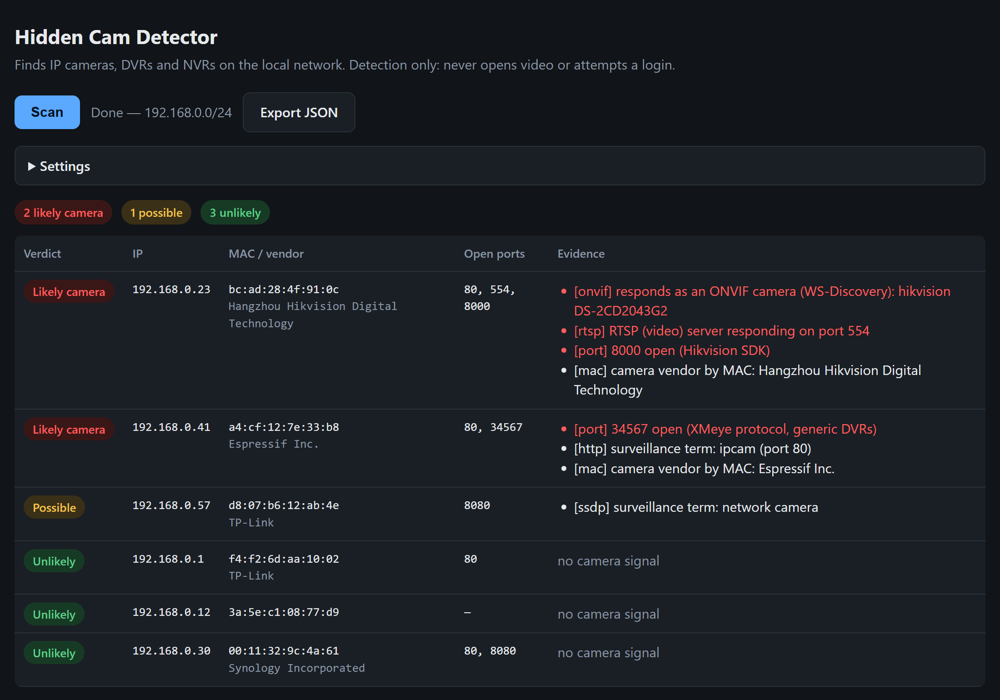

# Hidden Cam Detector

Scans the local network for IP cameras, DVRs and NVRs (for example, in an Airbnb or hotel) and shows the results in a local web UI.

**Detection only.** It never opens video, captures images or attempts logins or passwords.



<sub>Screenshot with demo data.</sub>

## Usage

### Option 1: prebuilt binary (easiest)

1. Download the file for your system from the GitHub **Releases** page:
   - Windows: `hidden-cam-detector-windows-amd64.exe`
   - macOS Apple Silicon: `hidden-cam-detector-darwin-arm64`; macOS Intel: `hidden-cam-detector-darwin-amd64`
   - Linux: `hidden-cam-detector-linux-amd64` or `-linux-arm64` (Raspberry Pi)
2. Run it. The browser opens automatically at `http://127.0.0.1:8765`.
   - macOS/Linux: `chmod +x hidden-cam-detector-*` before running. On macOS, if Gatekeeper blocks it: `xattr -d com.apple.quarantine hidden-cam-detector-darwin-*`.
3. Click **Scan**.

To verify the download, compare it against the release's `SHA256SUMS` (`sha256sum -c SHA256SUMS`, or `Get-FileHash` on Windows).

### Option 2: from source

Requires Go 1.23+.

```sh
go run .
```

Or build the binary with `go build`.

### Options

| Flag | Default | Description |
|---|---|---|
| `--listen` | `127.0.0.1:8765` | UI address. `0.0.0.0:8765` lets you open it from your phone, but exposes the panel to the whole network. |
| `--no-browser` | `false` | Do not open the browser. |

Subnet, extra ports and timeout are set in the UI itself. The subnet is detected automatically (capped at /24).

## How it detects

| Signal | Weight |
|---|---|
| Responds to ONVIF (WS-Discovery) | strong |
| RTSP server responding (554; also 8554 and 10554 when added as extra ports) | strong |
| Port 37777 (Dahua), 34567 (XMeye) or 8000 (Hikvision) open | strong |
| Camera brand in HTTP, SSDP/UPnP or RTSP banner | strong |
| Video service advertised via mDNS (`_rtsp._tcp`, `_axis-video._tcp`) | strong |
| Camera vendor by MAC | weak |
| Port 8899 (ONVIF) or 1935 (RTMP) open | weak |
| Generic term (DVR, NVR, CCTV…) in banner | weak |

Any strong signal = **likely camera**; only weak signals = **possible**; none = **unlikely**. The UI lists the evidence for each device. Weights, which probe runs on each port and the labels all live in `policy.go`.

For testing without a network, the scan talks to the world through the `Network` interface (`network.go`); tests use an in-memory adapter (`fakeNet`).

No admin rights, Npcap or nmap needed: it uses plain TCP connections, UDP multicast and the system ARP table.

### Limitations

- Cameras that record only to an SD card, have no Wi-Fi, or are on another network (host's separate Wi-Fi, 4G) do not show up.
- Hotel networks with client isolation hide other devices.
- Modern phones and laptops use random MACs (privacy); these show up without a vendor.

## Vendor list

Each MAC's vendor comes from `oui.txt` (about 40k prefixes), generated from the [Wireshark list](https://www.wireshark.org/download/automated/data/manuf), which derives from the IEEE registry. It is embedded in the binary and works offline. To update:

```sh
go generate ./...
```

Releases always refresh the list before building. Which vendors count as a camera signal is defined by `cameraVendorRe` in `policy.go`.

## API

| Method | Route | Description |
|---|---|---|
| `GET` | `/api/config` | Detected subnet, default ports and timeout |
| `POST` | `/api/scan` | Starts a scan. Body: `{"subnet":"192.168.0.0/24","extraPorts":[9000],"timeoutMs":700}`. `409` if one is already running |
| `GET` | `/api/devices` | Current state: `status`, `summary` (count per verdict) and `devices`, already sorted. Same JSON as "Export" |
| `GET` | `/api/events` | Server-Sent Events: `state` event with the same JSON as `/api/devices`, sent on every change (at most every 250 ms) |

## Release

Create and push a `v*` tag. The `.github/workflows/release.yml` workflow runs the tests, builds for the 5 targets and publishes the release with the binaries and `SHA256SUMS`:

```sh
git tag v0.1.0 && git push --tags
```

## Responsible use

Use it to protect your privacy where you are staying, or on networks you administer. The tool only identifies devices; it does not access video or try credentials.
